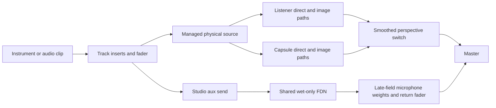

# Studio algorithmic Stage

The source branch is `feature/studio-complete-algorithmic-stage`. Its verified base, `35776eb401e1459106f04622c1784a9a95ae4b7e`, was also the published tip of `feature/studio-native-spatial-p4` when development began.

## Baseline audit

| Component | P4 behavior | Physical Stage behavior |
| --- | --- | --- |
| Stage sources | Normalized seats drive a stereo-balance insert and a depth-scaled Tracktion send. | Project seats drive managed stereo position, distance, elevation, radiation and first-order image reflections. |
| Shared return | One eight-line FDN and room-level early taps on a managed Tracktion aux. | The same return owns the new selectable FDN. Early reflections are calculated at each source and receiver. |
| Standalone Studio Spatial | P1/P2 position and stereo controls plus optional P4 local reflections. | Standalone control and project state retain their P4 behavior. |
| Microphones | Project state and placement/mixing UI. | An opt-in listening perspective with direct and reflected arrivals, capsule meters, and a stereo weighting for the shared late field. |
| Seating atlas | Validated C++ catalog and a separate macOS reference designer. | Search and explicitly assign eligible chart roles to project track IDs in the Stage workspace. |

## Signal flow



The Tracktion send takes the post-fader signal before the managed source processor. The managed source replaces the main track signal in either perspective. Bypass crossfades back to the track signal and silences the wet return. The return has one aux owner and one tank. The add-effect Studio Reverb uses the same FDN with a dry/wet path. Source snapshots are built on the edit thread and handed off through bounded atomic publication. Preparing the delay lines happens outside processing. The processor suspends silent sources once their history has drained.

The app continues using the P4 processing mode for version-one projects. **Stage controls → Adopt physical Stage** is a whole-project, undoable migration. The action validates the owned return, bus and source tracks, saves physical positions, replaces the managed panners and retains their send identities. The first **Enable stage audio** can create a physical scene automatically in a project that has no legacy Stage routes. Ordinary top-level audio and instrument tracks routed to the default output are supported. The Stage reports a routing restriction for frozen, grouped, custom-output and already spatialized tracks. Existing third-party inserts remain part of the track signal.

## Coordinates and microphone approximations

The origin lies at the center of the front room wall on the floor. +X runs from conductor-left to conductor-right while facing the musicians. +Y runs upstage and +Z runs up from the floor. The physical performance rectangle covers 82% of room width and 34–88% of room length. Track seats store absolute X/Y metres and source height. A venue change projects a seat outside the current performance rectangle to its nearest boundary while retaining the stored position. Screen X grows right and screen Y grows down. The catalog's original X runs conductor-left to conductor-right and chart Y runs from upstage to downstage, so conversion uses `2x - 1` across and `1 - y` in depth. Artwork-only, composite and multi-room plates remain reference entries. Atlas role placement changes the explicitly selected track's seat and records the layout, instrument and original marker IDs. Enable Stage audio separately for each desired track.

Listener and capsule horizontal positions are room-relative. Capsule height is in metres. XY, ORTF, spaced omnis, Blumlein, a Decca Tree-inspired array, main, outriggers, stage and spot presets use schematic positions with distances calibrated to the current venue when placed. For the Decca Tree-inspired preset, the center capsule sits one metre upstage of the side pair. Subsequent room resizing scales horizontal capsule positions with the room. Microphone paths use the earliest capsule arrival for each source as time zero and add the capsule's nonnegative delay. Older negative trims are treated as zero in the physical renderer. Figure-eight and supercardioid models retain rear-lobe polarity. Microphone mode takes a weighted mid signal plus a width-controlled stereo component on the direct path. The diffuse return follows capsule gain, pan, mute and solo. The shared tail uses a diffuse-field pickup approximation, with no capsule-specific late timing or metering. The displayed meters report the maximum direct/early contribution from one source per capsule before the summed perspective.

The bank supports six active capsules per project. A larger legacy setup can still be edited and recalled, and microphone monitoring becomes available once the active list contains six or fewer capsules. The two-microphone perspective is the practical starting point for larger sessions. The runtime skips the listener DSP once the microphone perspective has faded in and retains listener reflection history for switching back. First-order rays longer than the 250 ms listener history or 310 ms microphone history are omitted. The conservative radiation models provide broad low/high differences for nine source families. Binaural timing and shadow are based on the existing horizontal P2 renderer. Height contributes to propagation, damping and reflection geometry.

## Algorithmic reverb

Eco uses 4 independently modulated lines and 2 input diffusion sections per channel. Standard uses 8 lines and 4 sections. High uses 16 lines and 5 sections. All three use a normalized orthogonal feedback matrix, a bounded six-band feedback filter and fractional delay interpolation. Quality changes briefly fade the wet output around a tank reset. Delay storage is allocated for the largest mode to allow live switching. The baseline eight-line program remains selectable by the legacy state. Crossfades and parameter smoothing are bounded. The return includes output EQ and soft wet-only peak protection.

The original seven rooms remain available alongside original recording, classical and sacred presets. Studio Reverb adds creative voices, including an algorithmic plate and a sparse spring-inspired voice. Choose a preset using the search field, use **Basic** for decay, mix, predelay and trim, or **Advanced** for quality, buildup, modulation, EQ and per-band decay. User presets are stored in Studio's application settings and the active parameters travel with the project.

## Acoustic measurements

48 kHz, generated stereo impulse, Wood Concert Hall, 21 ms of specified predelay, all four modes measured wet. T30 estimates RT60 from the −5 to −35 dB portion of the reverse energy curve. Occupancy is the fraction of samples above −100 dBFS in the first 50 ms after the wet onset. The extra onset delay comes from the first modeled reflection.

| Mode | First arrival | Broadband T30 | Low T30 | High T30 | Early occupancy | Late L/R correlation |
| --- | ---: | ---: | ---: | ---: | ---: | ---: |
| P4 | 33.33 ms | 2.820 s | 3.980 s | 1.962 s | 20.1% | 0.000 |
| Eco | 33.33 ms | 2.881 s | 4.027 s | 1.935 s | 11.6% | −0.002 |
| Standard | 33.33 ms | 2.779 s | 3.881 s | 1.951 s | 24.0% | 0.008 |
| High | 33.33 ms | 2.749 s | 3.963 s | 1.871 s | 34.0% | −0.016 |

The original and current legacy-mode code produced byte-identical stereo output for an independent 128,000-frame source-and-tail comparison across all seven P4 factory venues at 44.1, 48 and 96 kHz. The result applies to the exercised project-compatible mode and fixtures. The benchmark runs active synthetic signals for 16, 32, 64 and 128 sources, at 44.1, 48 and 96 kHz with 64–1024 frame blocks. It reports delay storage, process CPU time and wall time. CPU percentages compare the time of sequential DSP work with the nominal period. They exclude Tracktion, audio hardware, instruments and device scheduling. The Linux measurements characterize this workstation only.

At 48 kHz and 256 frames, the isolated tank used 25.1 µs in Eco, 33.3 µs in Standard and 50.5 µs in High. Standard's delay memory and nominal single-process CPU load were:

| Active sources | Delay storage | Listener | Two capsules | Six capsules |
| ---: | ---: | ---: | ---: | ---: |
| 16 | 3.49 MiB | 7% | 6% | 14% |
| 32 | 6.49 MiB | 14% | 11% | 27% |
| 64 | 12.49 MiB | 33% | 23% | 55% |
| 128 | 24.49 MiB | 60% | 129% | 142% |

This stress matrix holds every source active throughout each run. The six-capsule and largest-session results show why capsule count should stay bounded and why these configurations need a real session benchmark. The current mode and publication can be profiled without a device, but the exact Intel MacBook load remains unmeasured.

## Build and listen on Intel macOS

Install Xcode with its command-line tools and have CMake on the command path. These are the repository's pinned Tracktion and JUCE dependencies.

```sh
git clone --branch feature/studio-complete-algorithmic-stage https://github.com/JonnyLost/Studio-Tracktion.git
cd Studio-Tracktion
git init build/deps/tracktion-engine
git -C build/deps/tracktion-engine fetch --depth 1 https://github.com/Tracktion/tracktion_engine.git c6293127cdc0a8488aea2ae0907f4709ee89c228
git -C build/deps/tracktion-engine checkout --detach FETCH_HEAD
git -C build/deps/tracktion-engine -c url.https://github.com/.insteadOf=git@github.com: submodule update --init --depth 1
cmake -S . -B build -G Xcode -DTRACKTION_ROOT="$PWD/build/deps/tracktion-engine" \
  -DCMAKE_OSX_ARCHITECTURES=x86_64 -DCMAKE_OSX_DEPLOYMENT_TARGET=14.0
cmake --build build --config Release --target Studio --parallel 3
open "$PWD/build/Studio_artefacts/Release/Studio.app"
```

The Spatial source DSP workflow publishes five original stereo listening WAVs, the impulse measurements and the benchmark matrix. To regenerate them locally:

```sh
mkdir -p listening
c++ -std=c++20 -O3 tests/SpatialStageTests.cpp SpatialStage.cpp SpatialReverb.cpp -o build/stage-dsp-tests
build/stage-dsp-tests
build/stage-dsp-tests --bench > listening/benchmark.csv
build/stage-dsp-tests --listening listening
```

1. Play Dry, P4 Wood Hall and Studio Reverb Wood Hall at a comfortable level. Listen to the attacks, left/right spread and the gap after the final note. Compare the farther-left Stage Listener and ORTF bounces on speakers and headphones.
2. In a disposable project with two dry instruments, open Stage, place each track and enable Stage audio. Move one track from a front seat to a rear seat while playing. Listen for attenuation, softer highs and changes in reflections.
3. Stop playback, open an older P4 project copy and compare its audio before and after adopting the physical Stage. Undo and redo adoption. Listen again after reopening the copy.
4. Open Microphones, place ORTF and choose **Monitor microphones**. Solo the left capsule, adjust its pan and delay, then mute both capsules. Return to the listener perspective.
5. Try a chamber room and a scoring stage in Rooms. Compare Standard and High on the short phrase. Check CPU on the actual session and use the usual device buffer settings.
6. Open **Studio Reverb** from a track's **Add Effect** menu. Compare a hall and a plate, save a preset and reopen the project. Export a stereo WAV with the proposed tail and listen through its end.
7. Float Stage and try the docked view at 1024×640 and 1280×800 in Graphite and Deep Black, including the largest text setting.

## Remaining acceptance work

Physical Stage and Studio Reverb provide the core positioning, room and microphone workflows above. Composer listening, physical Intel MacBook callback measurements and third-party Audio Unit session acceptance are required for release confidence. A single-point project listener has no elevation-dependent pinna cues. The limited virtual microphone model is a mix perspective for existing recorded signals. Individual capsule delay affects direct and reflected paths, and the shared diffuse return follows the mix's energy weights. Track and instrument recording through the app's existing regression suite should be interpreted according to the device and fixture used. No branch was merged.
