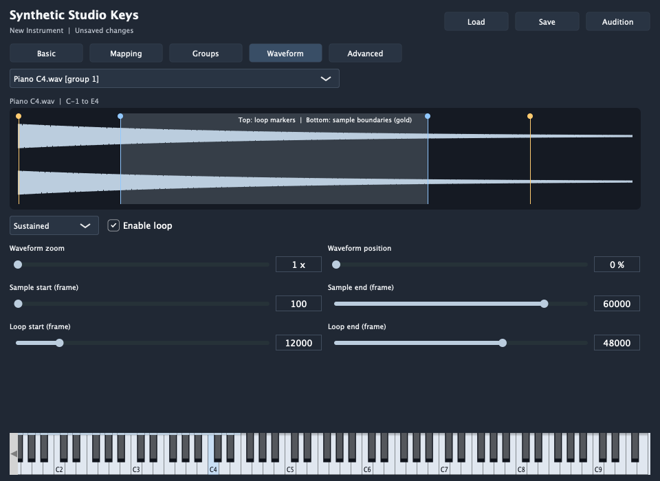
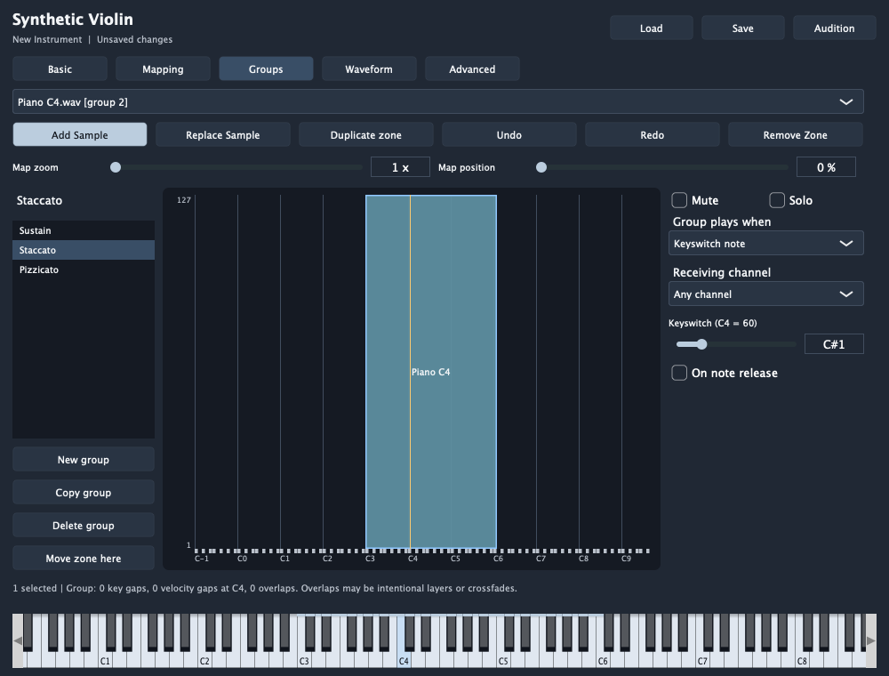
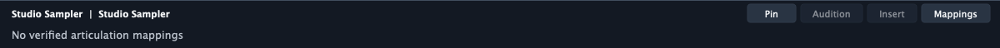

# Build Your First Studio Instrument

## Run Studio on an Intel MacBook

1. Quit any open copy of Studio. Sign in to GitHub and download **Studio-M11-Intel-app**. [Intel application artifact](https://github.com/JonnyLost/Studio-Tracktion/actions/runs/44972352991/artifacts/14733979776)
2. In Finder, unzip the downloaded archive and then `Studio-M11-Intel.zip` inside it. Move `Studio.app` into a separate folder such as `~/Applications/Studio M11` to keep your existing copy.
3. Open `Studio.app` on Intel macOS 14 or later. For this unsigned development build, macOS may require **System Settings → Privacy & Security → Open Anyway** after the first attempt to open it.
4. Start a new project and save it in a practice folder. In **Instruments**, select **Studio Sampler** and click **Add as New Track**. Open **Detailed Editor** from the Performance panel if it is closed.

[Build and launch from source](../README.md#build-and-launch-on-intel-macos)

## Exercise 1 · A two-layer keyboard instrument

Allow five minutes with a few short WAV or AIFF recordings. For a ready-made practice set, [download the synthetic starter kit](examples/Studio-First-Instrument.zip) and double-click the ZIP in Finder. Its four short WAV files are generated tones, not piano recordings. You can also load the included First Instrument preset to hear the finished two-layer example. Mono and stereo files are supported. Keep your recordings in a folder beside the instrument you will save.

1. Create a Sampler track in Studio, open its detailed editor and choose **Float** if you want more room.
2. Drag your recordings onto the sample display, or choose **Load Sample** and select several files or a folder.
3. Choose **Map Automatically**. Studio checks supported embedded root metadata and recognizes names such as `Piano_C4.wav`. C4 means MIDI note 60. Unidentified roots are provisionally assigned from C3, so check them before importing. An explicit filename range such as `Piano_C4_v1-63.wav` supplies the velocity limits.
4. Review the proposed notes and ranges. Select any recording in the preview to revise its root, key range or velocity range before committing. Choose **Import**, or **Cancel** to choose the other mapping approach. Manual mapping begins with each sample on its root note. After import, use Mapping to refine every range.
5. Click a rectangle to select a sample. Drag its left or right edge to change the range; drag the middle to move it. Shift-drag the middle to set its root. Use the readable root, key and velocity controls for precise adjustments. Command-click another rectangle to add it to the selection. Undo and Redo apply sampler edits.
6. For two velocity layers, duplicate a zone. With the starter kit, use its existing Soft and Loud zones. Set the softer zone's maximum velocity to 63 and the louder zone's minimum velocity to 64. Give both the same key range. Overlapping velocity ranges can layer or blend when you set the **Velocity fade in** and **Velocity fade out** controls in Mapping. A shared nonzero **Round-robin group** number makes eligible zones take turns.
7. Open **Groups** to create Piano Soft and Piano Loud. Select a zone, select a group, and choose **Move zone here**. Double-click the group name to rename it. **Copy group** copies its zones. **Delete group** moves its zones into a remaining group. Leave **Group plays when** on **Normal notes** for this exercise.
8. Click the keyboard to play the complete mapping. **Audition** plays the selected sample directly, even when the root is outside its assigned key range. Basic adjusts the instrument's envelope and volume.
9. Open **Waveform**. Gold lines mark sample boundaries; blue lines mark the loop. Drag in the top half to adjust loops and the bottom half to adjust sample boundaries. The frame controls provide precise values: frames are positions inside the recording, with larger numbers occurring later. With the starter kit, try loop start 2400 and loop end 14400. Enable Loop and audition to hear it. Zoom and Position let you inspect smaller regions. The original recording is never edited.
10. Double-click the instrument name, then choose **Save**. Studio writes a `.studiosampler` instrument. Close and reopen Studio, create a Sampler track, and choose **Load** to reopen it. The compact Performance panel remains available for composing without the detailed editor.

The selected outline shows which zone you are editing. Vertical position shows its velocity layer.

These groups organize the keyboard samples and use normal note playback. In the second exercise you will change the playback condition of each violin group.

Gold markers trim playback; blue markers define the repeating loop. These edits leave the recording untouched.

[Full keyboard exercise gallery](reviews/m10/README.md)

Keep the instrument and its sample subfolder together when moving them. Files below the instrument folder use relative references; files elsewhere retain absolute paths. For unavailable recordings, select the affected zone and choose **Locate Sample**. A shorter replacement may require resetting saved boundaries or disabling its loop first.

## Exercise 2 · A violin with Sustain, Staccato and Pizzicato

Use three recordings of the same pitch that you have permission to use, one for each playing style. C4 is convenient for a one-note exercise. You can practice the complete mapping and MIDI workflow with the starter kit's `Samples/Soft_C4.wav`. Copy it three times into a new `Samples` folder and name the copies `Sustain_C4.wav`, `Staccato_C4.wav` and `Pizzicato_C4.wav`. These generated tones will share a timbre. Different playback lengths make the switches audible.

1. Add a fresh Sampler track and name it **Violin**. In the sampler, use **Load Sample** to select the three files. Choose **Map Manually** and check that all three zones have the same root and key range. For the practice files, use root C4, low C4, high C4, and velocities 1–127 for every zone. Confirm import.
2. In **Groups**, rename the initial group **Sustain** by double-clicking its name above the list. Use **New group** and the same rename action to create **Staccato** and **Pizzicato**. On each pass, select the sample in the zone menu above the map, select the target group in the list and click **Move zone here**. Verify that selecting each group shows only its own zone in the map.
3. For each group, choose **Keyswitch note** under **Group plays when**. Set **Receiving channel** to **Channel 1**. Enter the note name or MIDI number in **Keyswitch**, and leave **On note release** clear for all three groups.

   | Group | Keyswitch | MIDI note |
   | --- | --- | --- |
   | Sustain | C1 | 24 |
   | Staccato | C#1 | 25 |
   | Pizzicato | D1 | 26 |

4. For the practice tones, use the **Waveform** page to set distinct durations. Leave Sustain on **Sustained**, set loop start to frame 2400 and end to 14400, and enable the loop. Try a **Loop crossfade** of 256 frames. Keep both shorter groups on **One-shot** with loops off, and set **Sample end** to 9600 for Staccato and 4800 for Pizzicato. With your own recordings, choose boundaries by ear and leave existing tails intact.
5. Close the detailed workspace and expose **Performance** or **Articulations only**. Select the Violin track. Its native group names appear as pads, and **Mappings** opens Groups directly. Click **Staccato**, then play C4 on channel 1 or use the editor keyboard. Repeat for each pad. To try the same workflow from hardware, send the switch note first and then play C4. The switch itself produces no sample sound. **Audition** in the detailed editor plays the selected sample directly and is useful for inspecting its trim.

   

6. With Violin selected in the arrangement, click **+ MIDI Clip**. The new region uses MIDI channel 1 and opens Piano Roll. With the strip visible, choose Sustain and use **Draw** to add C4 with a little space before the note. Repeat farther along the region with Staccato and Pizzicato. The Piano Roll can write the needed switch shortly before the drawn note in a compatible linear clip. Alternatively, use the strip's **Insert** at the playhead or draw the three switch notes manually ahead of their phrases. Use explicit switches in takes recorded from a MIDI keyboard.

   

7. Play from the start of the region so the switch messages run before the musical notes. Listen for the held, short and plucked phrases. Save the `.studiosampler` preset beside its sample folder and save the Studio project. Close and reopen the project, then replay the region from its start and check that the assignments still appear in Groups and in the strip.

## How the playback choices differ

| Feature | What it changes | Studio 0.2 M11 |
| --- | --- | --- |
| Articulation group | Selects sample zones for a playing style or layer. | Normal notes, latched keyswitches or inclusive MIDI CC ranges, with per-group channel, mute and solo. The first eligible keyswitch group is used before an explicit switch. Matching groups can layer. The native strip exposes playable keyswitch/CC groups. |
| Velocity layer | Selects or blends zones based on how hard a note is played. | Per-zone ranges and optional linear fade spans across overlapping ranges. Velocity is evaluated at note-on. |
| Round robin | Alternates eligible recordings of the same strike to vary repeats. | Set the same nonzero round-robin number in Advanced on the zones that should alternate. This number is independent of the named articulation group. Zero allows layering. |
| Release trigger | Plays a separate recording of the tail when the strike ends. | Enable **On note release** for a separate tail group. Studio captures eligible release groups at note-on, then plays them once at note-off or pedal lift. These release-only groups are configured in Groups. |
| True legato | Selects sampled transitions between pitches according to overlapping notes. | No sampled interval-transition engine. Sustain or a group named Legato plays its assigned samples. |

**Any channel** accepts incoming MIDI on all channels. The articulation strip sends on channel 1 for this setting. Use an explicit receiving channel when composing on another channel. For a separate release layer tied to an articulation, assign its tail group the same trigger and receiving channel as the attack group, then enable **On note release** on the tail group only.

The sampler supports 128 zones, 16 groups, up to 64 voices, 64 MiB decoded per source and 256 MiB per instrument. Interactive import, relink and preset preparation run in a cancellable worker. Project and undo restoration can decode uncached audio synchronously. Playback uses resident samples. Disk streaming, acoustic pitch detection and portable sample-copy export are deferred.

## Physical Intel MacBook checklist

- Use a MIDI keyboard and the MacBook's audio device to play the violin exercise. Check that the switches are silent, each following note uses the correct group, and a held note's separate release layer follows the articulation active at its attack. Test with and without a sustain pedal.
- Play the saved region, switch articulations while it runs, seek ahead of and behind the switch events, and Stop. Check for hanging notes or stale switches. Reopen the saved project and verify zones, assignments, and playback again.
- At 1280 × 800 and 1024 × 640, try **Float**, **Dock**, **Mappings**, the lower workspace modes, trackpad resizing and enlarged text. Check that trigger fields and the playable keyboard stay reachable.
- Import a larger folder, cancel once, and try a successful import. Play an existing track while the sampler prepares files and listen for audio dropouts. Check audio latency and sustained load with your device and sample set.

[Milestone 11 phone gallery](reviews/m11/README.md) · [Sampler technical notes](native-sampler.md)
