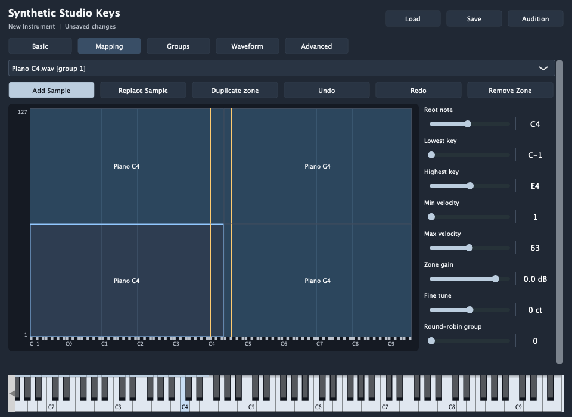
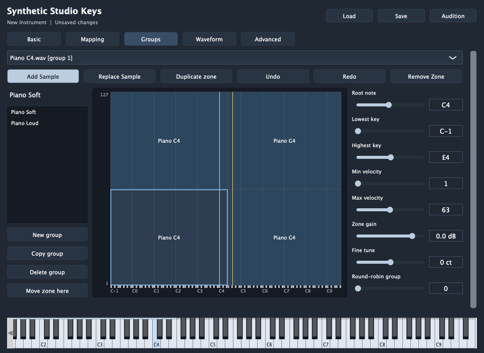

# Build Your First Studio Instrument

To try this Intel build, open the [validated macOS CI run](https://github.com/JonnyLost/Studio-Tracktion/actions/runs/44947285800), download **Studio-M10-Intel-app** under Artifacts, and unzip the downloaded archive and the Studio ZIP inside it. Move Studio.app to Applications. This development build requires Intel macOS 14 or newer and is unsigned; macOS may ask you to approve opening it.

Allow five minutes with a few short WAV or AIFF recordings. For a ready-made practice set, [download the synthetic starter kit](examples/Studio-First-Instrument.zip) and double-click the ZIP in Finder. Its four short WAV files are generated tones, not piano recordings. You can also load the included First Instrument preset to hear the finished two-layer example. Mono and stereo files are supported. Keep your recordings in a folder beside the instrument you will save.

1. Create a Sampler track in Studio. Open its detailed editor; use Float if you want more room.
2. Drag your recordings onto the sample display, or choose **Load Sample** and select several files or a folder.
3. Choose **Map Automatically**. Names such as `Piano_C4.wav` provide the original note: C4 means MIDI note 60. Names without a reliable note receive provisional notes starting at C3. Studio does not listen to guess pitch.
4. Review the proposed notes and ranges. Select any recording in the preview to revise its root, key range or velocity range before committing. Choose **Import**, or **Cancel** to choose the other mapping approach. Manual mapping begins with each sample on its root note. After import, use Mapping to refine every range.
5. Click a rectangle to select a sample. Drag its left or right edge to change the range; drag the middle to move it. Shift-drag the middle to set its root. Use the readable root, key and velocity controls for precise adjustments. Command-click another rectangle to add it to the selection. Undo and Redo apply sampler edits.
6. For two velocity layers, duplicate a zone. With the starter kit, use its existing Soft and Loud zones instead of duplicating them. Set the softer zone's maximum velocity to 63 and the louder zone's minimum velocity to 64. Give both the same key range. Overlapping velocity ranges deliberately play layers together. A nonzero **Round-robin group** number makes matching zones take turns instead.
7. Open **Groups** to create Piano Soft and Piano Loud. Select a zone, select a group, and choose **Move zone here**. Double-click the group name to rename it. **Copy group** copies its zones; **Delete group** moves its zones into a remaining group.
8. Click the keyboard to play the complete mapping. **Audition** plays the selected sample directly, even when the root is outside its assigned key range. Basic adjusts the instrument's envelope and volume.
9. Open **Waveform**. Gold lines mark sample boundaries; blue lines mark the loop. Drag in the top half to adjust loops and the bottom half to adjust sample boundaries. The frame controls provide precise values: frames are positions inside the recording, with larger numbers occurring later. With the starter kit, try loop start 2400 and loop end 14400. Enable Loop and audition to hear it. Zoom and Position let you inspect smaller regions. The original recording is never edited.
10. Double-click the instrument name, then choose **Save**. Studio writes a `.studiosampler` instrument. Close and reopen Studio, create a Sampler track, and choose **Load** to reopen it. The compact Performance panel remains available for composing without the detailed editor.

The selected outline shows which zone you are editing. Vertical position shows its velocity layer.

Named groups keep related recordings together. They do not switch or mute the instrument.

Gold markers trim playback; blue markers define the repeating loop. These edits leave the recording untouched.

[Full native macOS screenshot gallery](reviews/m10/README.md)

Keep the instrument and its sample subfolder together when moving them. Files below the instrument folder use relative references; files elsewhere retain absolute paths. For unavailable recordings, select the affected zone and choose **Locate Sample**. A shorter replacement may require resetting saved boundaries or disabling its loop first.

Limits: 128 zones, 16 organizational groups, 64 voices, 64 MiB decoded per recording and 256 MiB per instrument. Import reports files it cannot accept. Loading and decoding currently run on the message thread and may briefly pause the interface. Audio rendering performs neither disk access nor decoding.

Deferred: acoustic pitch detection, disk streaming, portable sample-copy export, velocity crossfades, editable loop crossfade, keyswitch groups and articulation switching. Organizational groups do not mute or switch layers. The existing fixed loop smoothing remains in the playback engine. Import review allows root, key and velocity edits before committing. Graphical edits after import can be undone.
