# Milestone 10: native Sampler gallery

Actual Studio application state captured on the **Intel macOS CI runner**, not mockups. All audio shown is mathematically generated synthetic WAV/AIFF test material, not piano or commercial library recordings.

Each embedded image is an unmodified, readable render of the live native application component. **Tap it to open the corresponding full-resolution macOS WindowServer screenshot** with the real application window. Both originals are included; no compositing or image-generation tools were used. The native desktop captures are 1920 x 1080; the indicated compact Studio view is 1280 x 800.

[Validated Intel build, tests and downloadable app](https://github.com/JonnyLost/Studio-Tracktion/actions/runs/44947285800) · [Linux tests](https://github.com/JonnyLost/Studio-Tracktion/actions/runs/44947285822) · [Build Your First Studio Instrument](../../build-your-first-studio-instrument.md) · [Engineering notes](engineering.md) · [CI and performance results](ci-results.md)

Capture source: runtime commit `18ecb85`; automated sampler and instrument-workspace reviews. The workspace review displays the live production Studio view in a native test shell for WindowServer capture.

## 1. Empty sampler

A fresh Sampler with an import prompt; no sample library is required.

[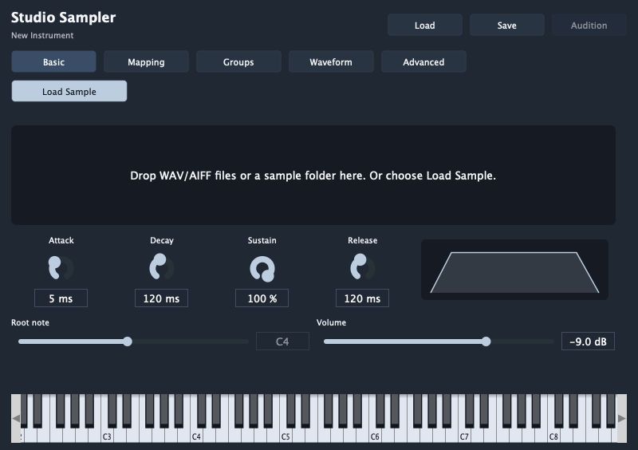](editor-native-sampler-empty.png)

[Application render](editor-sampler-empty.png) · [Full-resolution native window](editor-native-sampler-empty.png)

## 2. Mapping several recordings

Two generated WAV/AIFF samples mapped across the keyboard. The outlined rectangle is selected; the right inspector edits its root, note range and velocity range.

[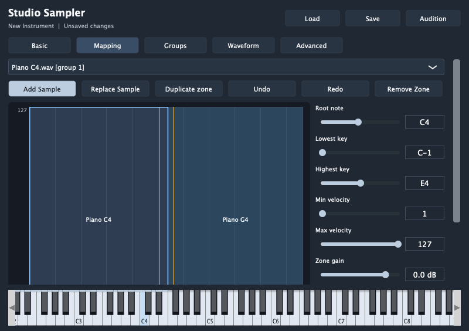](editor-native-sampler-mapping.png)

[Application render](editor-sampler-mapping.png) · [Full-resolution native window](editor-native-sampler-mapping.png)

## 3. Two velocity layers

Four zones share two key ranges. Soft zones use velocities 1-63 and loud zones use 64-127. Gold lines mark roots.

[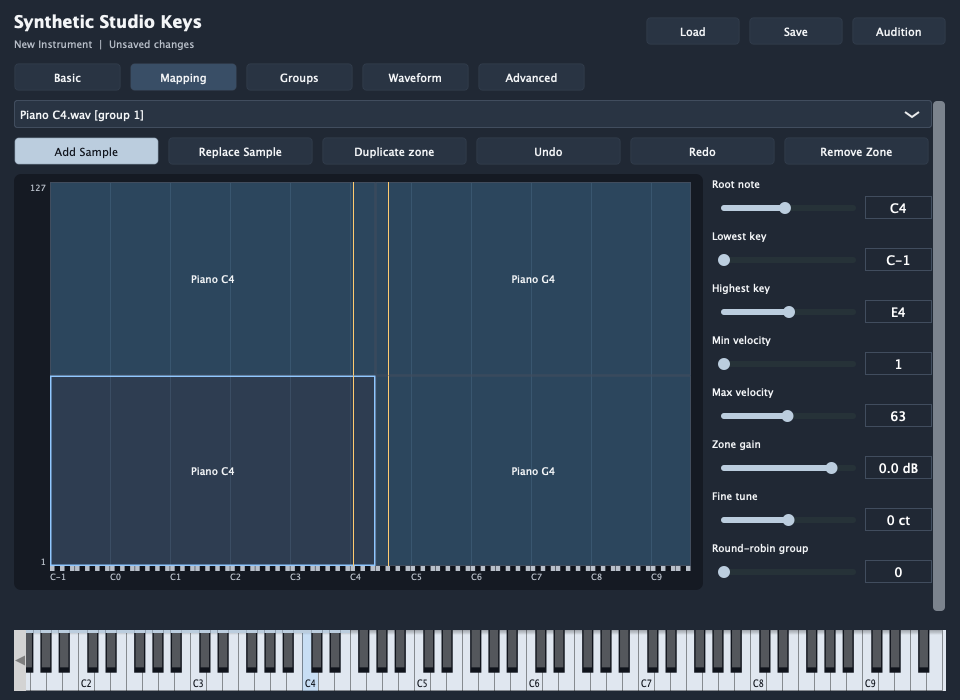](editor-native-sampler-velocity-layers.png)

[Application render](editor-sampler-velocity-layers.png) · [Full-resolution native window](editor-native-sampler-velocity-layers.png)

## 4. Named instrument groups

Piano Soft and Piano Loud organize the synthetic instrument. Group membership is independent of round-robin configuration.

[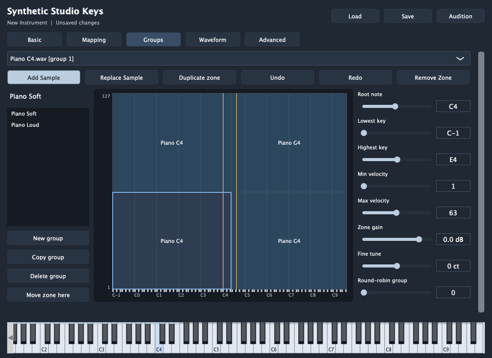](editor-native-sampler-groups.png)

[Application render](editor-sampler-groups.png) · [Full-resolution native window](editor-native-sampler-groups.png)

## 5. Sample boundaries and loops

Gold boundaries trim playback from frame 100 to 60000; blue markers loop frames 12000-48000. The enabled loop changes actual playback.

[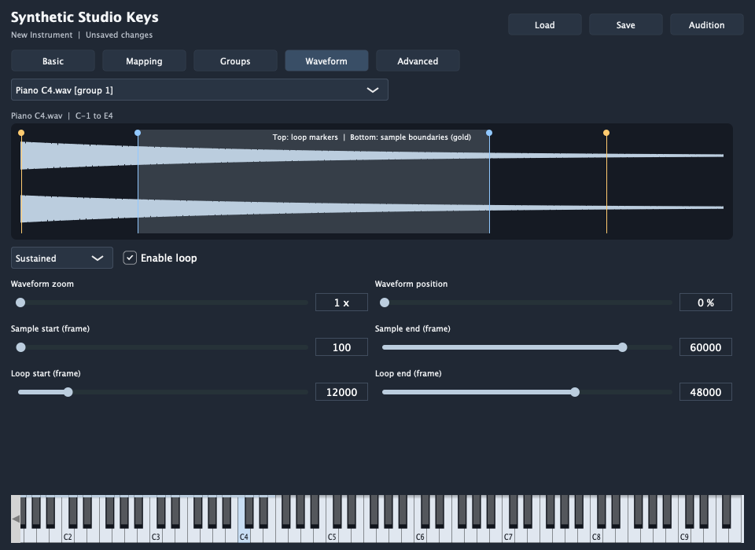](editor-native-sampler-waveform.png)

[Application render](editor-sampler-waveform.png) · [Full-resolution native window](editor-native-sampler-waveform.png)

## 6. Basic performance controls

Envelope, instrument volume, selected sample root and a playable audition keyboard, with the Load/Save/Audition toolbar.

[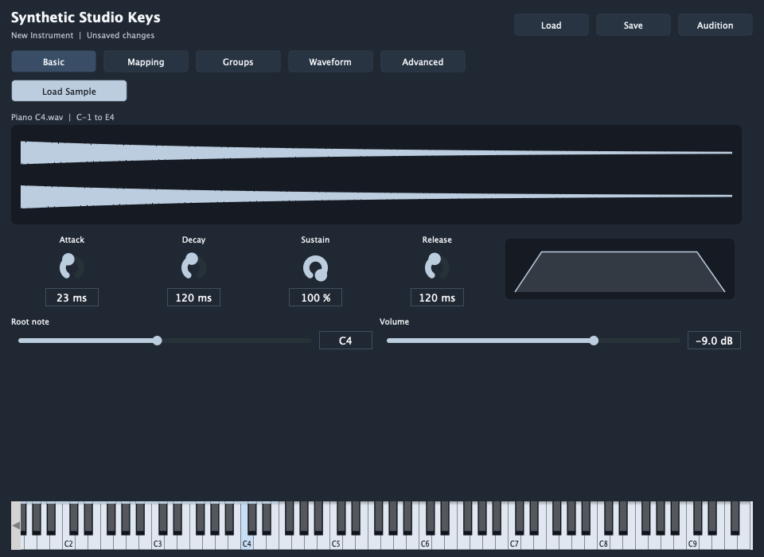](editor-native-sampler-builder-basic.png)

[Application render](editor-sampler-builder-basic.png) · [Full-resolution native window](editor-native-sampler-builder-basic.png)

## 7. Instrument in Studio lower workspace

The real Studio view with a loaded Sampler, the docked detailed editor, compact Performance controls and the existing articulation strip.

[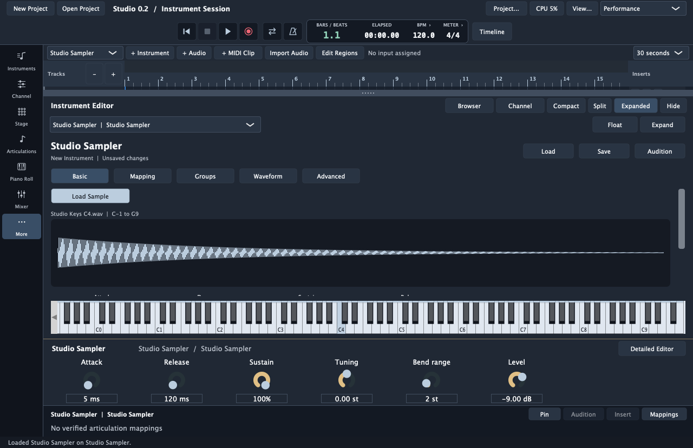](workspace-native-sampler-docked.png)

[Application render](workspace-sampler-docked.png) · [Full-resolution native window](workspace-native-sampler-docked.png)

## 8. Floating detailed editor

The editor floats in its native window with Dock available. Automated playback checks continue while floating.

[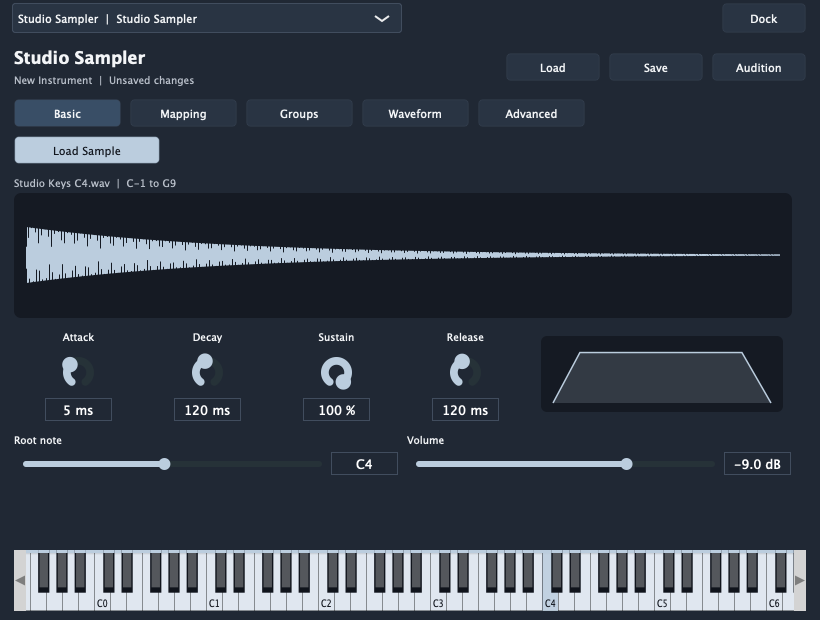](workspace-native-sampler-floating.png)

[Application render](workspace-sampler-floating.png) · [Full-resolution native window](workspace-native-sampler-floating.png)

## 9. Docked mapping editor

The detailed mapping page docked inside Studio, while the fixed-height Performance panel remains track-specific.

[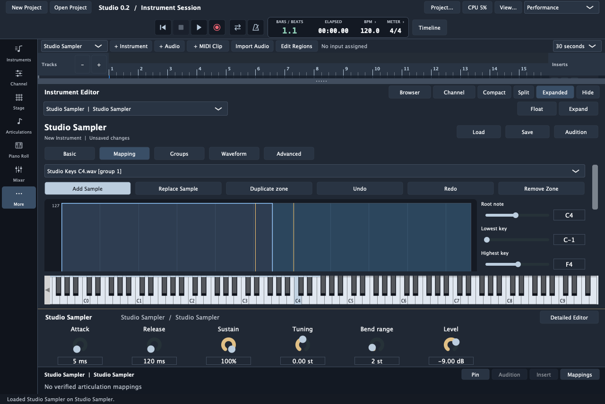](workspace-native-sampler-mapping.png)

[Application render](workspace-sampler-mapping.png) · [Full-resolution native window](workspace-native-sampler-mapping.png)

## 10. 1280 x 800 MacBook layout

The Studio application view is 1280 x 800 after saving and reopening the project. Tap for the uncropped native desktop capture.

[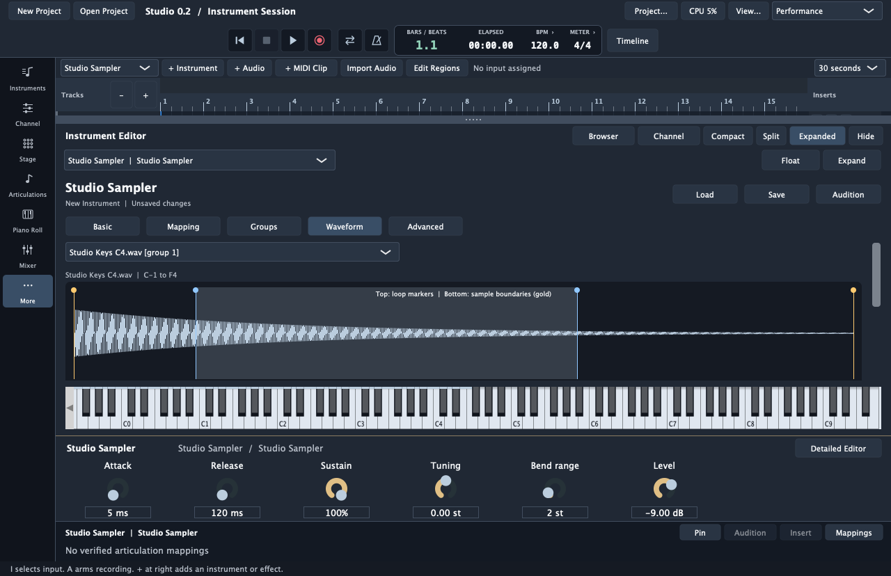](workspace-native-sampler-reopened-1280x800.png)

[Application render](workspace-sampler-reopened-1280x800.png) · [Full-resolution native window](workspace-native-sampler-reopened-1280x800.png)

## 11. Saved custom instrument reopened

The synthetic two-layer Builder instrument was saved as .studiosampler and reloaded, preserving groups, layers and playback settings.

[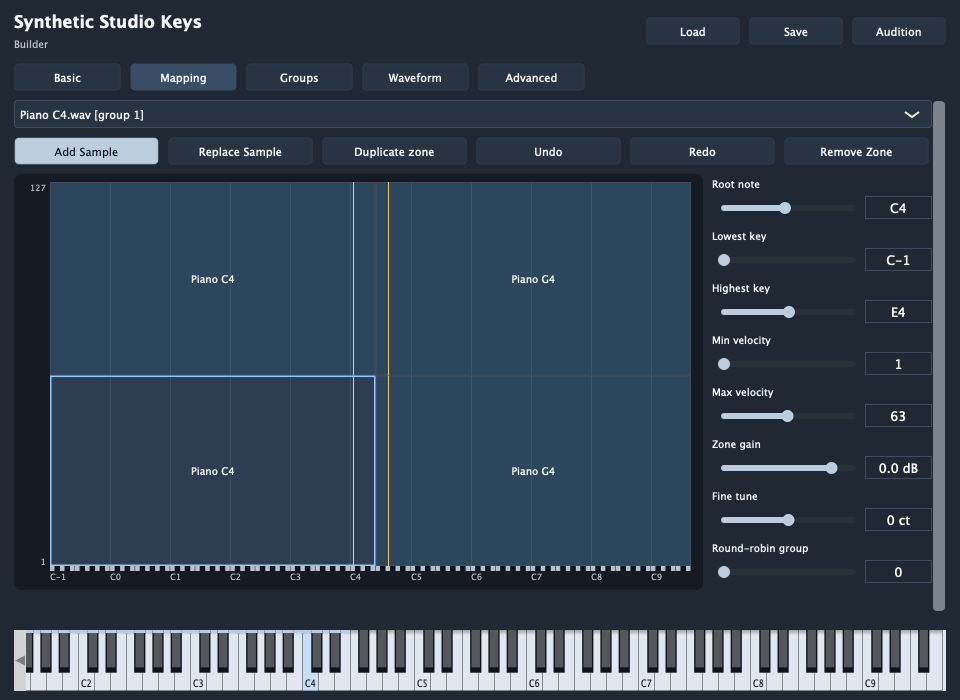](editor-native-sampler-reopened.png)

[Application render](editor-sampler-reopened.png) · [Full-resolution native window](editor-native-sampler-reopened.png)

## 12. Loop editing docked in Studio

Loop markers in the detailed editor alongside Studio performance controls.

[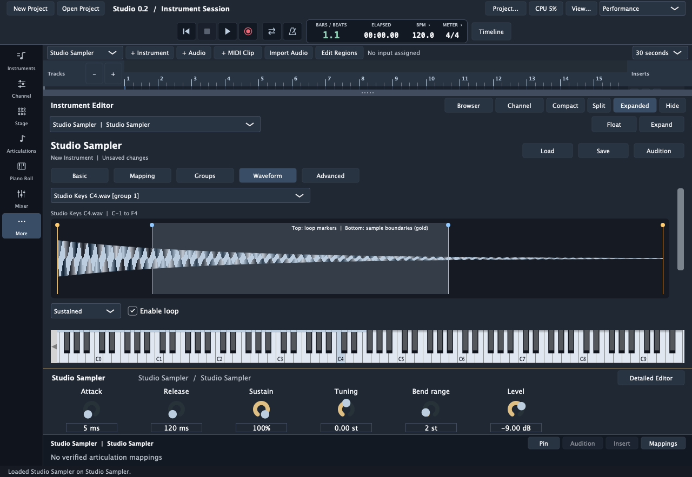](workspace-native-sampler-loops.png)

[Application render](workspace-sampler-loops.png) · [Full-resolution native window](workspace-native-sampler-loops.png)

## 13. Compact Performance without detailed editor

The project has reopened and the detailed workspace is closed. The compact Sampler panel and articulation strip remain available for composing.

[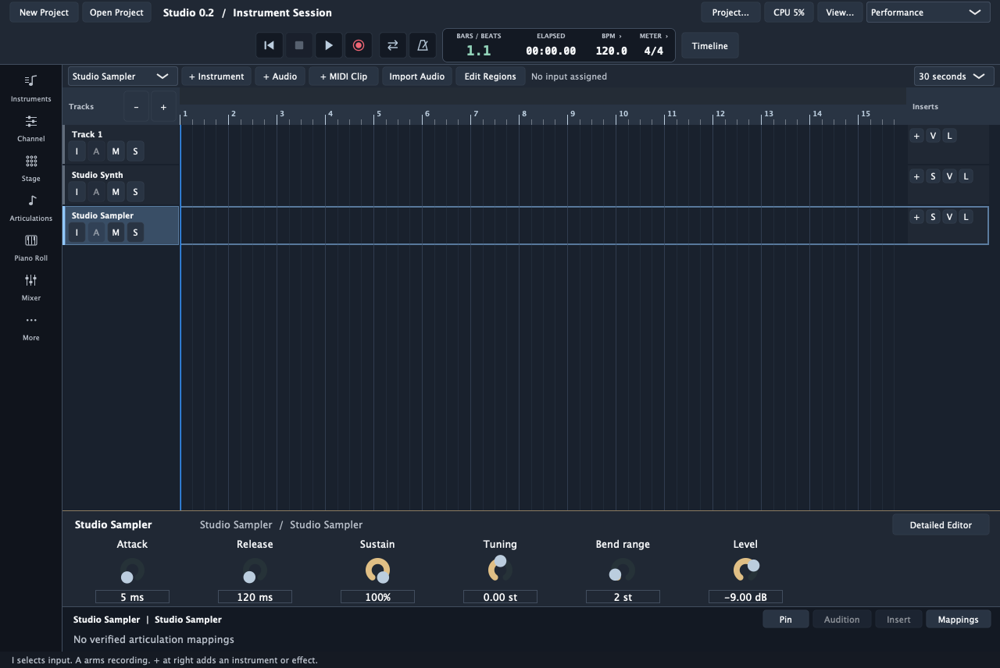](workspace-native-sampler-performance-1280x800.png)

[Application render](workspace-sampler-performance-1280x800.png) · [Full-resolution native window](workspace-native-sampler-performance-1280x800.png)
