# Milestone 11 Sampler review

These captures show Studio running on the Intel macOS CI runner. The sample instruments use synthetic test audio. The violin and horn names identify fixtures used to verify articulation switching.

On a phone, tap a preview to open its full-size application image or matching desktop screenshot. The narrow keyswitch, CC and release details are direct crops of the application captures. The 1920 × 1080 desktop PNGs are original WindowServer screenshots, including the macOS window and desktop. [Original Sampler captures](https://github.com/JonnyLost/Studio-Tracktion/actions/runs/44962012706/artifacts/14730476766) · [Original workspace captures](https://github.com/JonnyLost/Studio-Tracktion/actions/runs/44962012706/artifacts/14730172939)

[Build Your First Studio Instrument](../../build-your-first-studio-instrument.md) · [Physical MacBook checklist](../../build-your-first-studio-instrument.md#physical-intel-macbook-checklist) · [Unsigned Intel Studio app](https://github.com/JonnyLost/Studio-Tracktion/actions/runs/44972352991/artifacts/14733979776)

## Mapping and velocity layers

[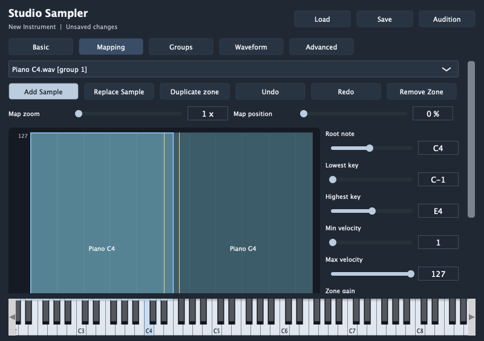](01-mapping-macos.png)

The selected zone exposes its root, key range and velocity limits. The gold marker shows its root note. [Full desktop capture](01-mapping-macos.png)

[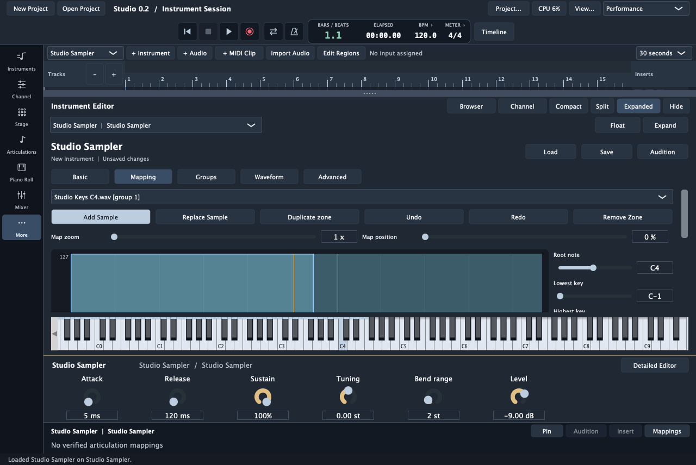](01-docked-mapping-macos.png)

The full Studio view keeps the track and arrangement above Mapping, with the performance controls below it. [Full desktop capture](01-docked-mapping-macos.png)

[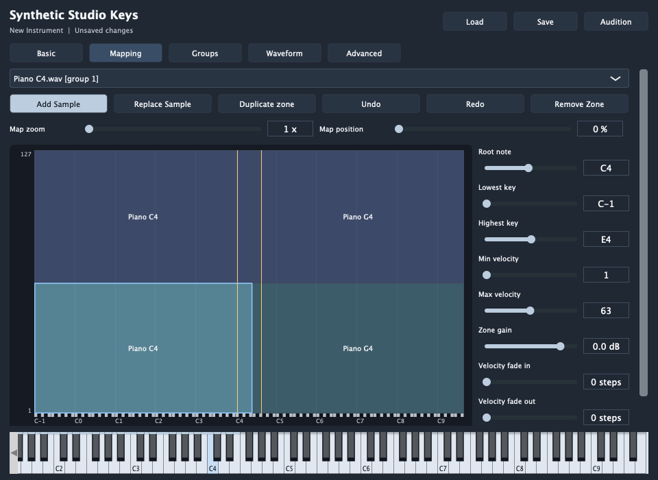](02-velocity-layers-macos.png)

Soft and loud recordings occupy different vertical ranges on the same keys. [Full desktop capture](02-velocity-layers-macos.png)

## Groups and keyswitches

[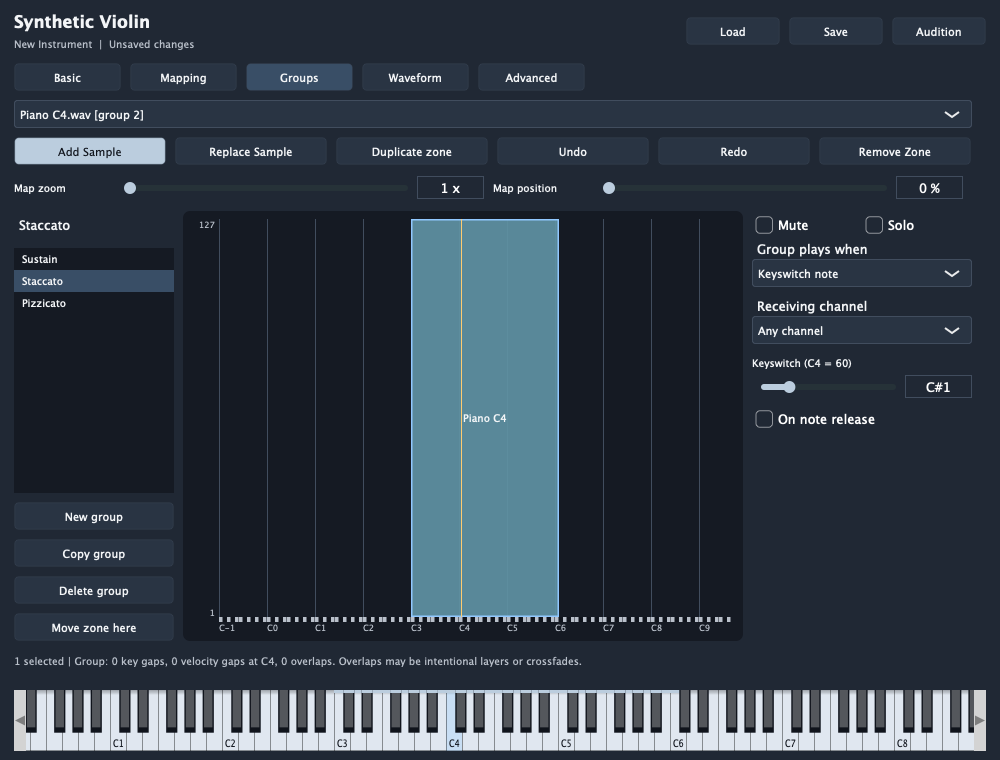](03-groups-macos.png)

The left list contains Sustain, Staccato and Pizzicato. The map shows zones from the selected group. In this example, Staccato is assigned C♯1 (MIDI 25). [Full desktop capture](03-groups-macos.png)

[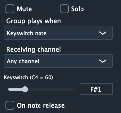](04-keyswitch.png)

This view shows the same group's assignment edited to F♯1 (MIDI 30). The latch applies on the receiving MIDI channel, and the switch note itself is silent. [Full editor](04-keyswitch.png) · [Full desktop capture](04-keyswitch-macos.png)

## MIDI CC and release triggers

[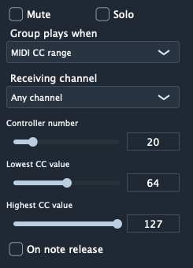](05-midi-cc.png)

The group here responds to CC20 values from 64 through 127. The CC numbering and ranges are configured per group. [Full editor](05-midi-cc.png) · [Full desktop capture](05-midi-cc-macos.png)

**On note release** turns the selected group into a release-sample layer. Studio evaluates the group when the musical note begins, then starts its samples once at note-off or sustain-pedal lift. For a playable instrument, keep the main attack samples in their own group and put the recorded tails in a separate release group. [Full editor](06-release-trigger.png) · [Full desktop capture](06-release-trigger-macos.png) · [Supplemental Sampler artifact](https://github.com/JonnyLost/Studio-Tracktion/actions/runs/44972352991/artifacts/14734890810)

## Waveform and loop crossfade

[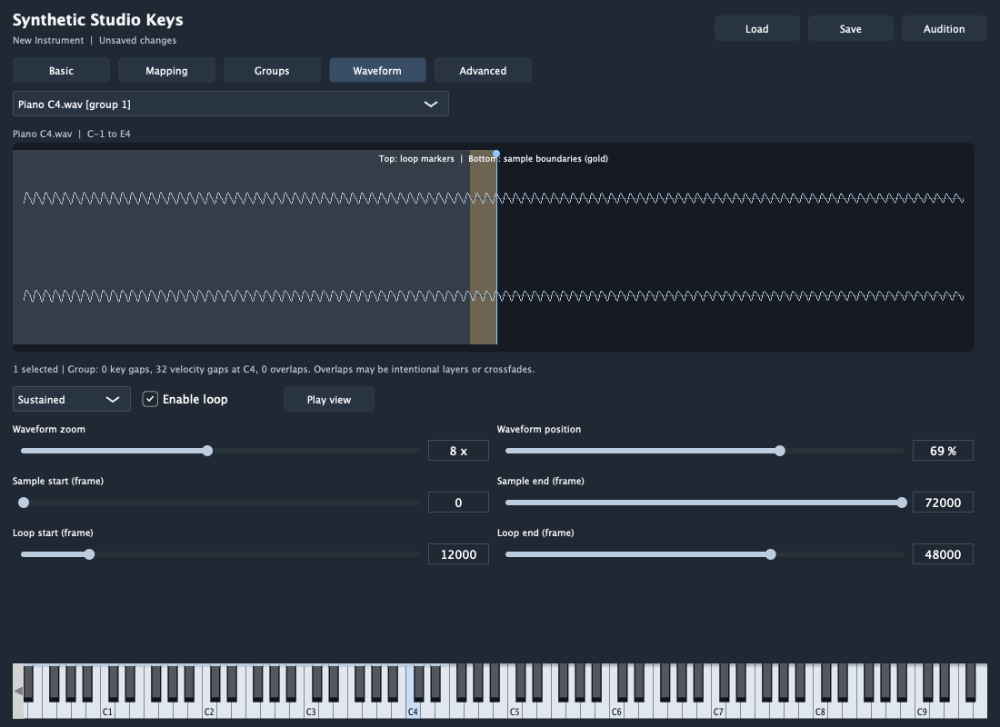](07-loop-crossfade-macos.png)

The Waveform page shows the blend window near the loop seam. The review fixture uses a 256-frame crossfade. **Play view** auditions the visible portion of the recording. [Full desktop capture](07-loop-crossfade-macos.png)

## Articulation strip follows the selected track

[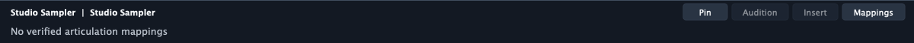](08-violin-strip.png)

Selecting Pizzicato on the native Violin track sends its verified keyswitch. The arrangement capture includes the generated violin MIDI clip. [Full Studio view](08-violin-strip.png) · [Full desktop capture](08-violin-strip-macos.png)

[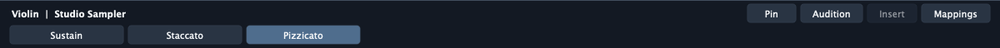](09-horn-strip.png)

Switching to French Horn changes which verified groups the strip shows. Returning to Violin retains the violin selection. [Full Studio view](09-horn-strip.png) · [Full desktop capture](09-horn-strip-macos.png)

## Docked and floating editor

[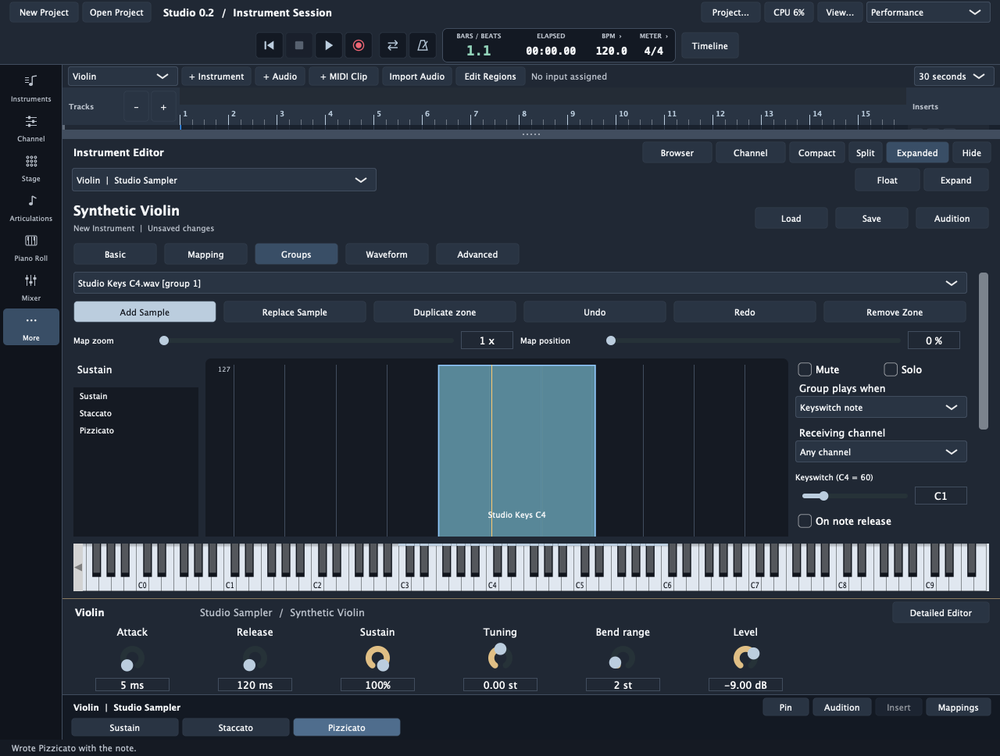](10-docked-groups-macos.png)

**Mappings** on the strip opens the native Groups page directly in the lower workspace. The track panel remains available. [Full desktop capture](10-docked-groups-macos.png)

[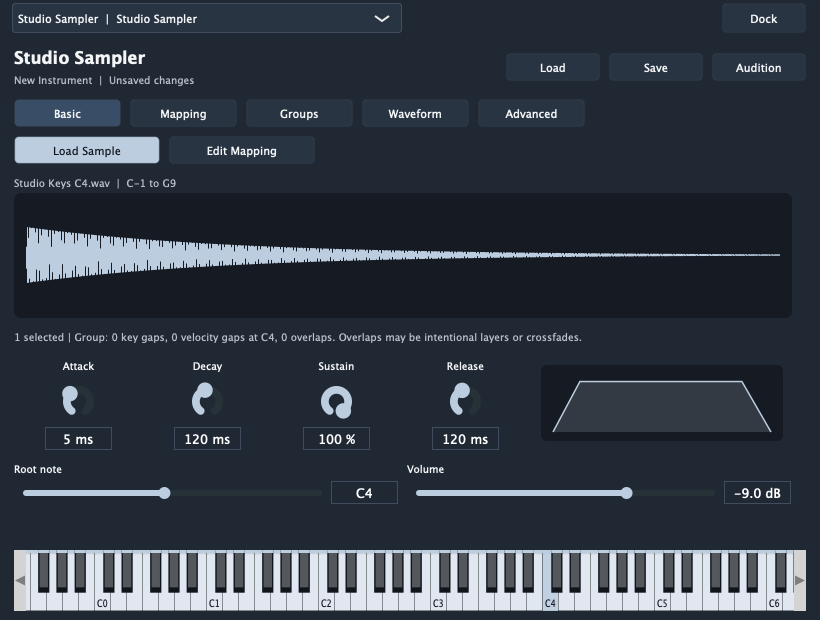](11-floating-macos.png)

The same detailed editor can float separately. **Dock** returns it to the main workspace. [Full desktop capture](11-floating-macos.png)

## Compact MacBook layout

[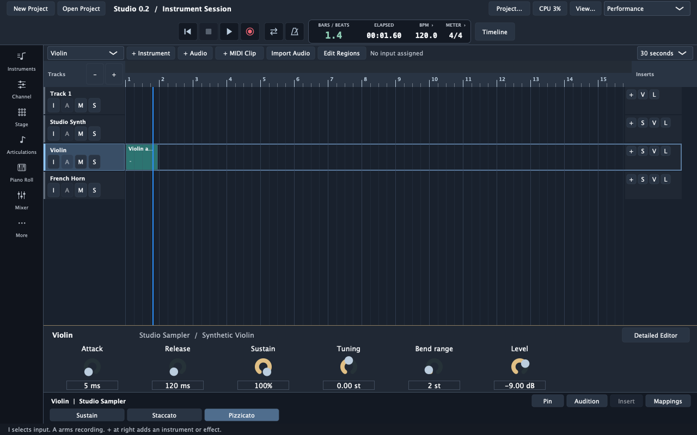](12-compact-macos.png)

The Studio application image measures 1280 × 800. It keeps the selected Violin's Performance controls and articulation strip available with the detailed editor closed. The desktop capture includes the macOS window frame. [Full desktop capture](12-compact-macos.png) · [Supplemental workspace artifact](https://github.com/JonnyLost/Studio-Tracktion/actions/runs/44972352991/artifacts/14734950569)
