# Milestone 9 interface review

Studio 0.2 running on the Intel macOS CI runner. Open any image to see the full PNG. The Chamber Sketch project uses factory Synth presets, a synthetic Sampler source, and labeled MIDI mapping and unavailable Audio Unit fixtures.

Studio captured these views during its automated workspace review. [Intel macOS capture run](https://github.com/JonnyLost/Studio-Tracktion/actions/runs/44908802022)

## Header and arrangement

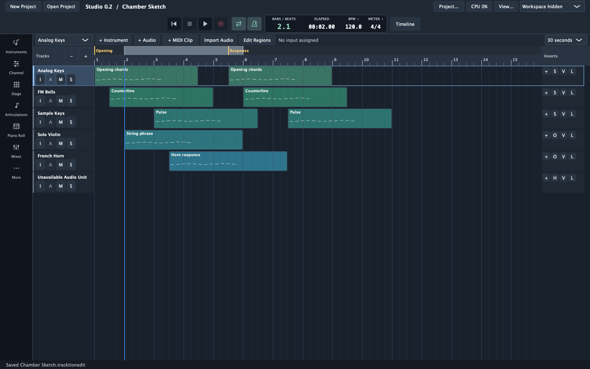

The centered display makes bars and beats the largest readout. Cycle and metronome are lit, and the Project menu holds file, export and configuration commands.

## Studio Synth

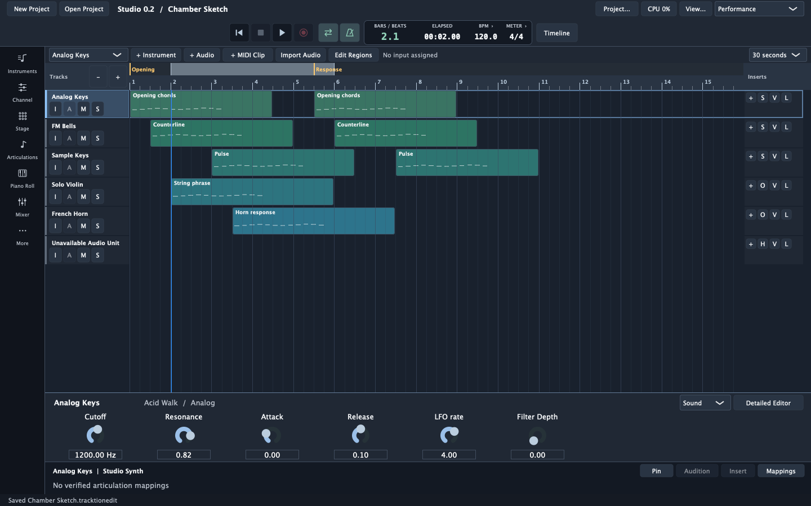

Analog exposes cutoff, resonance, envelope and filter modulation controls for the selected preset.

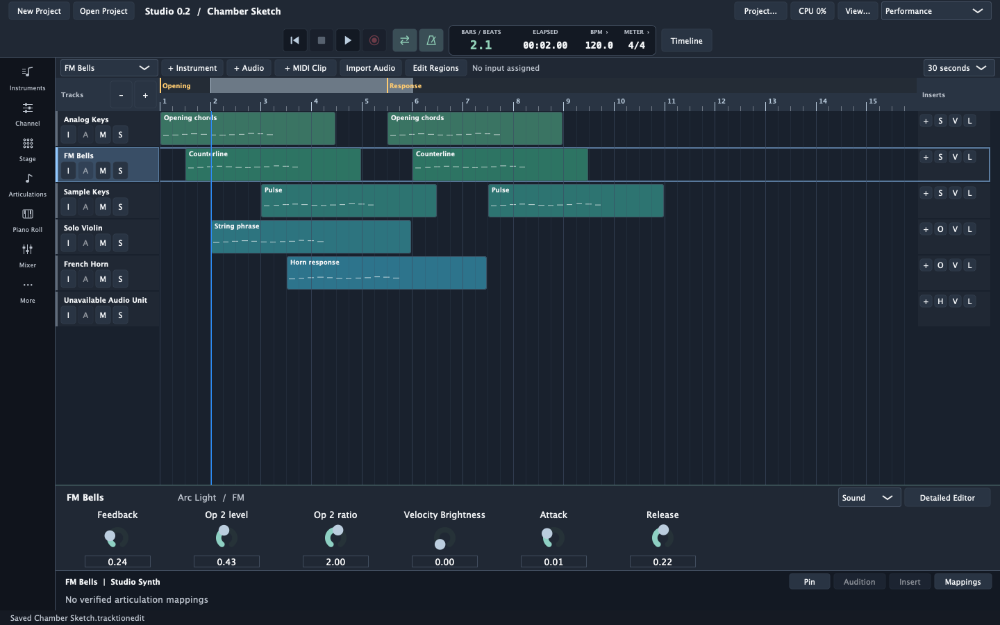

FM uses the same panel height and shows feedback, operator 2, velocity brightness and envelopes.

## Studio Sampler

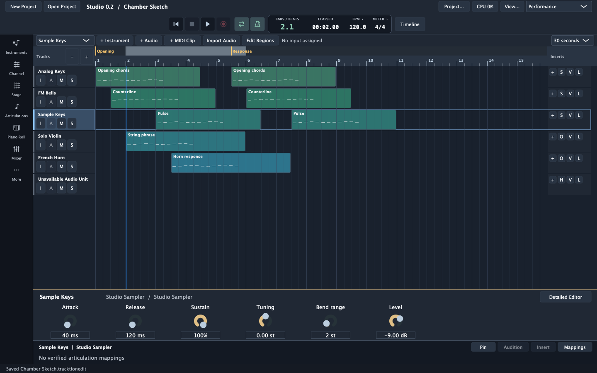

Attack, release, sustain, tuning, bend range and level are directly accessible. Detailed Editor opens sample mapping and loop editing.

## Orchestral mapping fixture

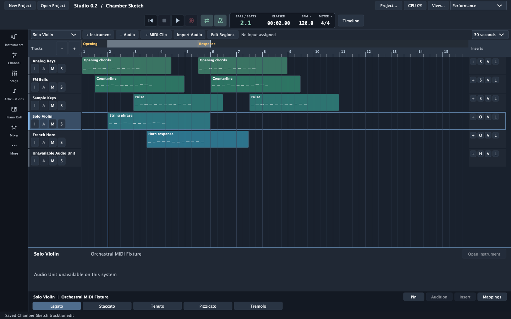

Legato is active for the Solo Violin fixture. Audition and Insert remain separate actions. The unavailable Audio Unit panel identifies the fixture and exposes the mappings stored for that instrument.

## Articulation strip while composing

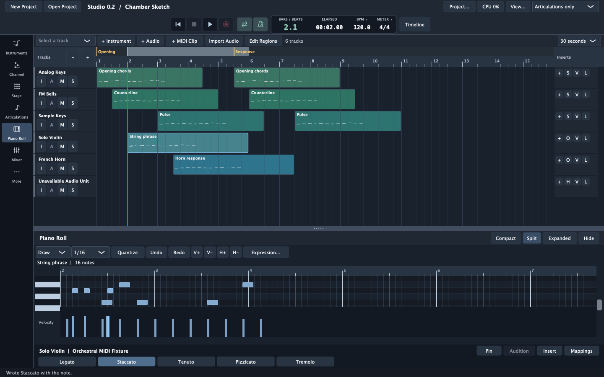

The shallow strip leaves the note editor visible and highlights Staccato for the violin track.

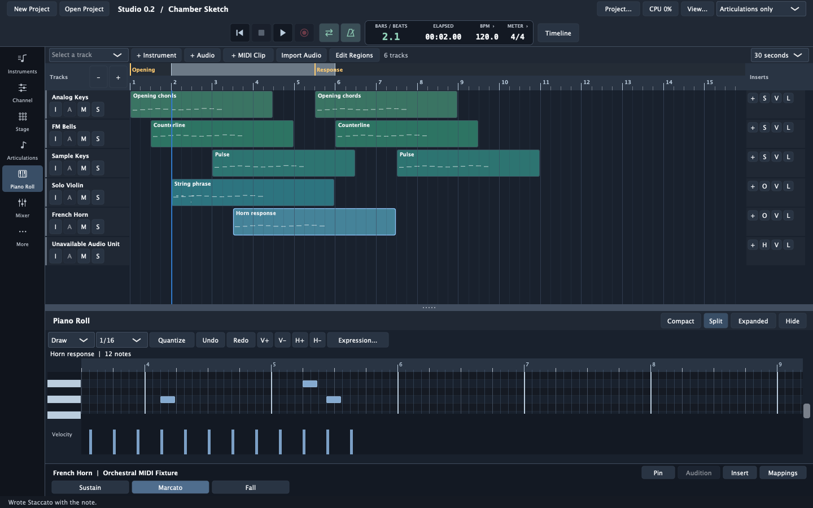

The same strip follows the French Horn track and highlights Marcato. These are test mappings and do not establish the behavior of a library patch.

## Detailed editor Float and Dock

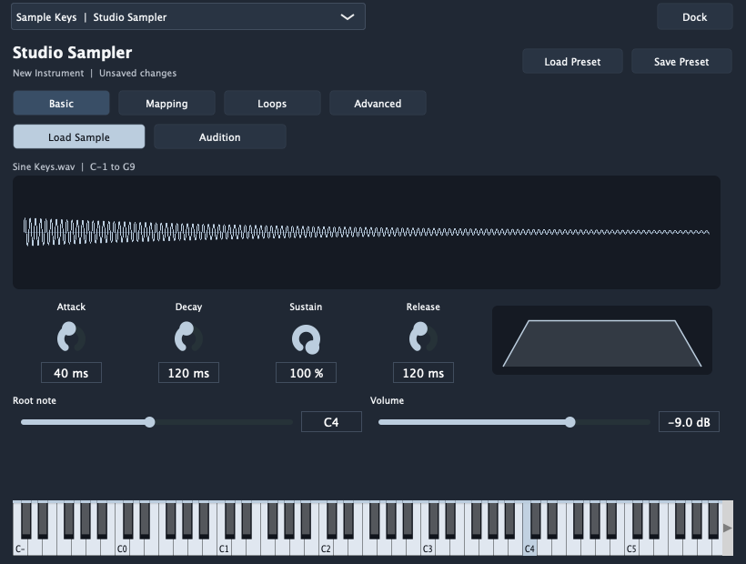

The detailed Sampler editor detaches from the main window and offers Dock.

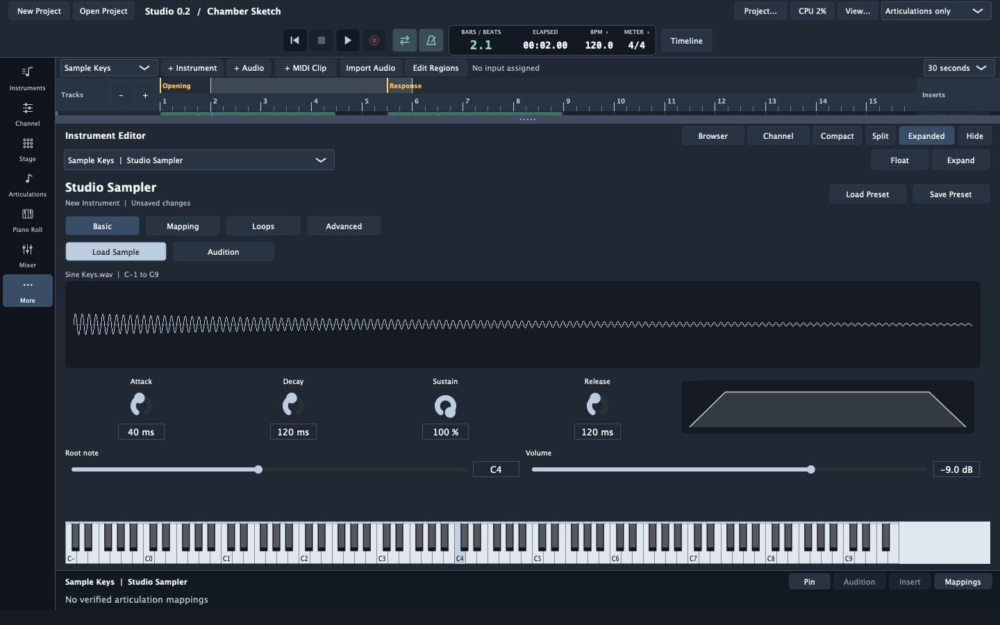

Dock returns the same editor to Studio. The articulation strip can stay at the bottom in either state.

## Maximum arrangement and MacBook layout

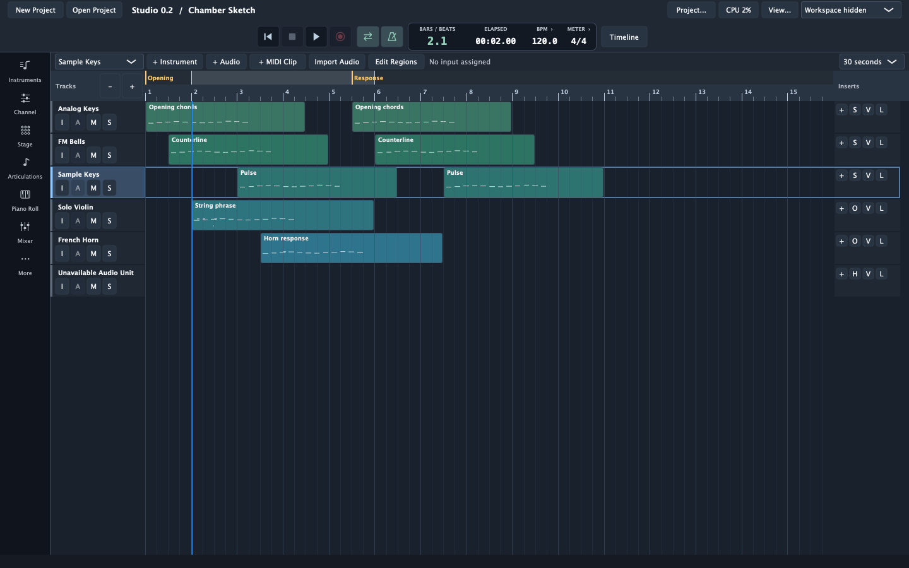

Hidden frees the area previously occupied by the lower workspace.

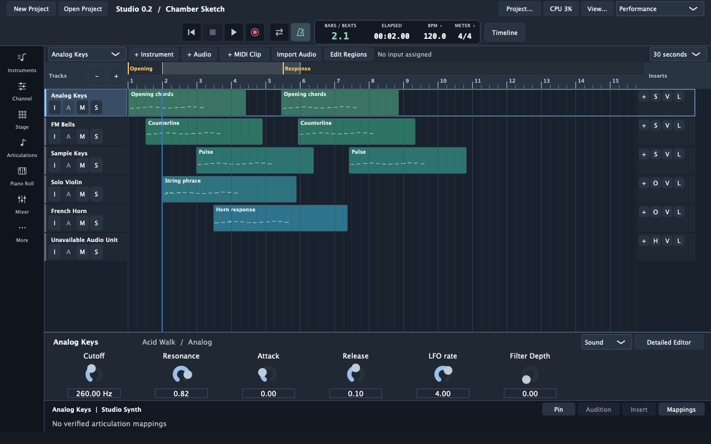

The compact MacBook view keeps the transport, track commands and principal instrument controls within the window.

## Unavailable Audio Unit fixture

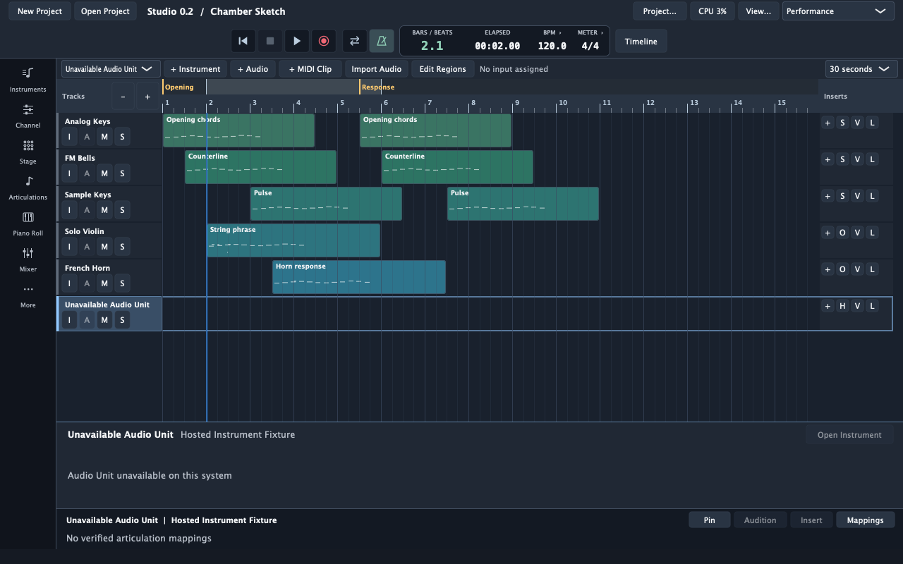

Studio identifies the unavailable plug-in and disables Open Instrument. A live Audio Unit provides its discoverable parameters and opens in its vendor window. The fixture does not verify installed ARIA.

[Workspace controls and validation notes](../../adaptive-workspace-m9.md)
